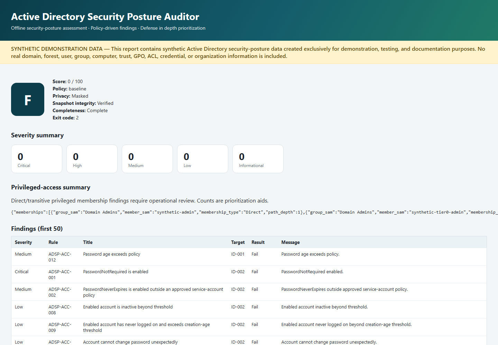
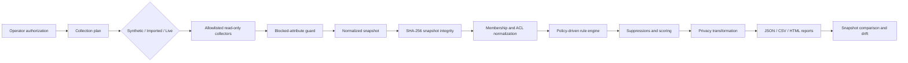

# Active Directory Security Posture Auditor

[](https://github.com/salvomazzaglia/active-directory-security-posture-auditor/actions/workflows/ci.yml)


PowerShell-first **Active Directory security-posture assessment** toolkit for offline snapshot analysis, privileged-access review, and policy-driven findings — without modifying Active Directory.



> The screenshot, snapshots, reports, directory objects, memberships, GPOs, trusts, and ACLs in this repository contain synthetic demonstration data only. No real Active Directory environment or organization information is included.

> Live collection performs read-only directory queries but still accesses sensitive identity and infrastructure metadata. Use it only with explicit authorization and protect raw snapshots accordingly.

> This project does not retrieve passwords, password hashes, Windows LAPS passwords, gMSA managed-password blobs, tickets, or replication secrets.

> A high posture score is not a security certification and does not prove that an Active Directory environment is secure.

## Value proposition

Operators need a repeatable way to review **identity exposure** and **potentially risky configuration** across privileged groups, account hygiene, Kerberos/delegation, service accounts, Windows LAPS metadata, trusts, selected GPO settings, and critical-object ACLs — using **offline snapshot analysis** or an explicitly acknowledged **read-only directory query**.

This project complements portfolio work such as `sysadmin-health-check`, `backup-integrity-verifier`, `network-device-watch`, `self-hosted-runner-hardening-lab`, `endpoint-incident-triage`, and `container-security-baseline` by adding a distinct Active Directory and identity-security dimension.

## Problem being solved

Directory posture drift accumulates quietly: nested privileged membership, stale privileged accounts, unconstrained delegation, broad LAPS readers, weak LDAP signing representations, and unexpected ACL control. Many teams lack a safe, offline-first, policy-as-code auditor that never retrieves secrets and never modifies the directory.

## Authorization warning

Live mode is only for environments you own or are explicitly authorized to assess. Dual acknowledgement is mandatory (`-AcknowledgeLiveDirectoryQuery` and `-AuthorizedUse`).

## Offline-first design

Synthetic and imported modes never query a domain. CI never runs live collection and never imports ActiveDirectory for live queries.

## Live-collection safety

- Never the default
- Never self-elevates
- Never prompts for or stores credentials
- Allowlisted read-only collectors only
- Blocked-attribute registry
- Truncation warnings (never silent)
- Does not follow external trusts to query another forest

## Main features

- Synthetic / imported / live source modes
- Privileged-access review with transitive expansion and cycle detection
- Account, Kerberos, delegation, service-account/gMSA metadata analysis
- Windows LAPS metadata and permission analysis (never password values)
- Trust, selected GPO, and critical-object ACL review
- Credential-clue detection on allowlisted descriptive attributes with full redaction
- Policy profiles, transparent scoring, reviewed suppressions
- Snapshot integrity hash (SHA-256, not a digital signature)
- Security-drift comparison
- JSON / CSV / standalone HTML reports with Masked (default), Hashed, and Full privacy modes

## Supported environments

**Live collection:** Windows 10/11 or Windows Server 2019+ with RSAT/`ActiveDirectory` (optional `GroupPolicy` / LAPS metadata modules). Windows PowerShell 5.1 or PowerShell 7 where compatible.

**Offline analysis:** Windows PowerShell 5.1; PowerShell 7.4+ on Windows or Ubuntu. No domain membership, RSAT, or administrator rights required.

Live support on Linux is not claimed.

## Quick start

```powershell
Import-Module ./ADSecurityPosture/ADSecurityPosture.psd1
pwsh ./scripts/adsp-audit.ps1 version
pwsh ./scripts/adsp-audit.ps1 synthetic -OutputDirectory temp/synthetic
pwsh ./scripts/adsp-audit.ps1 audit `
  -Snapshot examples/synthetic-snapshot/snapshot.json `
  -Policy config/baseline.policy.json `
  -OutputDirectory temp/report `
  -Format All `
  -PrivacyMode Masked
```

## Synthetic demonstration

```powershell
pwsh ./scripts/generate-synthetic-data.ps1
pwsh ./scripts/generate-sample-reports.ps1
```

## Offline audit / compare / plan / rules

```powershell
pwsh ./scripts/adsp-audit.ps1 plan -Domain corp.example.invalid -CollectionProfile Standard
pwsh ./scripts/adsp-audit.ps1 list-rules
pwsh ./scripts/adsp-audit.ps1 explain -RuleId ADSP-PRV-003
pwsh ./scripts/adsp-audit.ps1 compare `
  -Before examples/comparison/before.json `
  -After examples/comparison/after.json `
  -Policy config/baseline.policy.json `
  -OutputDirectory temp/comparison
```

## Live collection (authorized environments only)

```powershell
pwsh ./scripts/adsp-audit.ps1 collect `
  -AcknowledgeLiveDirectoryQuery `
  -AuthorizedUse `
  -Domain corp.example.invalid `
  -CollectionProfile Standard `
  -OutputDirectory snapshots
```

## Policy profiles, scoring, suppressions, privacy, integrity

- **baseline** / **strict** / **legacy-compatible** policies in `config/`
- Score starts at 100; Critical −25, High −15, Medium −7, Low −2; grades A–F
- Suppressions require justification, owner, expiration, and review reference
- Masked (default), Hashed (salt via `ADSP_PRIVACY_SALT`), Full (explicit)
- Snapshot hash is integrity verification of canonical JSON — not origin proof

## Architecture



## Testing and CI

```powershell
pwsh ./scripts/run-ci.ps1
```

GitHub Actions uses only GitHub-hosted runners (`windows-latest`, `ubuntu-latest`), pins actions to full commit SHAs, and never runs live collection.

## Security and limitations

This project is **not** Microsoft Defender for Identity. It does not provide behavioral detection, monitor authentication traffic, inspect endpoint memory, retrieve password hashes, retrieve LAPS passwords, or retrieve gMSA managed-password blobs. It does not replace professional AD assessment, penetration testing, identity monitoring, or incident response. Offline snapshots can become stale immediately. Findings often **require review**. Scores are prioritization aids, not certification.

Roadmap-only mentions: Microsoft Entra ID, AD CS, AD FS, DNS analysis, Defender for Identity integration, continuous monitoring.

## Skills demonstrated

Active Directory Domain Services · Identity security · PowerShell · Privileged-access review · Group Policy · Kerberos · Windows LAPS · Service accounts · gMSA · AD ACL analysis · Security posture assessment · Policy as code · Drift detection · Pester · PSScriptAnalyzer · GitHub Actions · Cross-platform testing · Threat modeling · Technical documentation

## Contributing / License / Author

See [CONTRIBUTING.md](CONTRIBUTING.md), [SECURITY.md](SECURITY.md), and [LICENSE](LICENSE).

**Author:** Salvatore Mazzaglia ([@salvomazzaglia](https://github.com/salvomazzaglia))

**Repository:** https://github.com/salvomazzaglia/active-directory-security-posture-auditor
